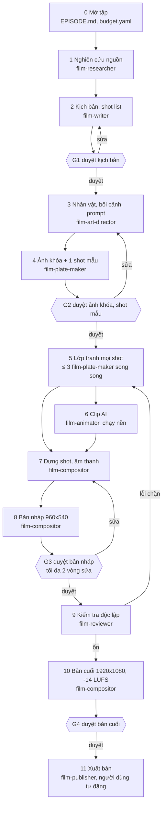

# Quy trình làm một tập phim

Bản cho người đọc. Phiên chính (đạo diễn) làm theo skill `.claude/skills/film-pipeline/`. Schema file và tên:
`docs/CONVENTIONS.md`.

## 1. Sơ đồ



## 2. Khâu, người làm, cổng

| # | Khâu | Ai làm | Đầu ra | Cổng |
|---|---|---|---|---|
| 0 | Mở tập (dự án mới: tạo thư mục Drive và `PROJECT.md` trước) | đạo diễn | `EPISODE.md`, `budget.yaml`, thư mục tập trên Drive | người dùng chốt độ dài, style, **phương pháp dựng**, trần chi phí |
| 1 | Nghiên cứu nguồn | đạo diễn → `film-researcher` | bảng `## Sinh vật của tập` (khi `SERIES.md` có `owner_refs.required`: xin ảnh sách của chủ dự án **trước**), `research.md` (nguyên văn, link, cách đọc tên) | – |
| 2 | Kịch bản, shot list | `film-writer` | `script.md`, `shots.csv` | **G1** |
| 3a | Thiết kế sinh vật (tập `blender`/`code` có sinh vật chính) | `film-researcher` → đạo diễn | `characters/<slug>/ICONOGRAPHY.md`, 2–3 concept Qwen-Image local (`tools/concept.py`), `CHARACTER.md` `## Concept đã duyệt` | người dùng chọn concept; `status.py --gate G2` kiểm |
| 3 | Thiết kế nhân vật, bối cảnh | `film-art-director` | `characters/*/CHARACTER.md`, `locations/*/LOCATION.md`, `prompts/`, `prompts.csv` | – |
| 4 | Ảnh khóa | `film-plate-maker` | ảnh khóa nhân vật + đủ lớp 1 shot mẫu (2K) | **G2** trước khi tạo hàng loạt |
| 5 | Lớp tranh (`layers`: theo lô `ark.py image-batch`, gồm plate tư thế) | `film-plate-maker` (≤ 3 song song) | `out/.../plates/`, `prompts.csv`, `anchors.json` | – |
| 6 | Clip AI (`method: seedance`, hoặc `blender` có `ai_motion`; `layers`/`code` bỏ qua khâu này). `video_engine: comfy` = clip MiniMax H3 local thay Seedance | `film-animator` (nền) | `out/.../clips/` | – |
| 7 | Dựng shot, âm thanh | `film-compositor` | film.html theo shot, `review/sound-audit.md`; nhạc code/foley theo sự kiện (nếu dùng): `score.json` trong thư mục tập → stem ở `out/.../audio/` (`tools/audio/score.py`, miễn phí) | – |
| 8 | Dựng cả tập | `film-compositor` | bản nháp 960×540 | **G3** (tối đa 2 vòng sửa) |
| 9 | Kiểm tra độc lập | `film-reviewer` (chỉ đọc sản phẩm, ghi qc) | `review/qc-<v>.md` | lỗi chặn → quay lại khâu gây lỗi |
| 10 | Bản cuối | `film-compositor` | 1920×1080, -14 LUFS, lưu Drive | **G4** |
| 11 | Xuất bản | `film-publisher` | `publish.md` | người dùng tự đăng |

Cổng duyệt luôn ở phiên chính. Agent không hỏi người dùng, không tự qua cổng. Trước mỗi cổng phiên chính chạy
`python3 tools/check_episode.py episode <thư mục tập> --out review/check-v<N>.txt` (thêm `--probe` từ G3; file chỉ được ghi
khi có `--out`); còn ERROR thì chưa trình duyệt.

### Bốn phương pháp dựng

Mỗi tập chọn **một** phương pháp ở khâu 0, ghi `method: layers | seedance | code | blender` trong `EPISODE.md` (không có
khóa = `seedance`; tập mới từ mẫu = `layers`). Không trộn trong một tập. `layers` và `seedance` dùng chung khâu 0–5 và 7–11;
`code` bỏ khâu 5–6; `blender` đổi nghĩa khâu 3–6 (xem dưới). Cả bốn dùng chung cổng G1–G4, ledger, quy trình sửa theo
ghi chú và lưu lịch sử.

| | `layers` | `seedance` | `code` | `blender` |
|---|---|---|---|---|
| Hình từ đâu | lớp tranh Seedream | lớp tranh Seedream + clip | vẽ bằng code (`tools/toon/`) | model 3D render bằng Blender |
| Trả tiền | ảnh | ảnh + giây video | không | không (trừ clip Seedance nếu chọn) |
| Chạy ở đâu | mọi phiên | mọi phiên | mọi phiên | khâu 4–6: **chỉ phiên local** trên máy chủ lab |
| Style | ảnh | ảnh | `engine: code` | `engine: blender` |
| Khâu 6 | bỏ | clip (`video_engine`) | bỏ | tuỳ chọn, clip (`video_engine`) |

| | `layers` | `seedance` |
|---|---|---|
| Cái gì tạo chuyển động | code trên lớp tranh: vải, tóc (`cloth`), đuôi, cỏ (`strip-warp`), cây (`foliage`), khói (`smoke`), lửa (`fire`, `embers`), sương (`mist-bands`), máy quay; hành động lớn = đổi bậc 2–4 plate tư thế (`pose-cycle`, 8–12 fps) | như `layers` cho không khí và máy quay; cử động lớn của nhân vật là clip Seedance đã tách nền |
| Trả tiền cho | ảnh (model giá thấp, tạo theo lô `ark.py image-batch`, nền dùng lại giữa các shot) | ảnh + giây video (phần đắt nhất của tập đầu tiên) |
| Khâu chạy | 0–5, 7–11; **khâu 6 bỏ qua** | 0–11 |
| `budget.yaml` | `video_seconds: 0` | `video_seconds` > 0 |
| `shots.csv` | `ai_motion` trống; plate tư thế = mã lớp `L4b`, `L4c`… | `ai_motion` ở shot cần clip |
| Nhân vật | giữ tư thế, không trượt, không xoay; thường nhìn từ sau lưng | cử động liên tục được (bước, quay đầu, vỗ cánh) |
| Chọn khi | cần chi phí thấp; chuyện kể bằng không khí, máy quay, tư thế; phong cách tranh + nhân vật 2D tô phẳng | tập cần cử động thân thể liên tục mà code không làm được (đi, bay, vật lộn) và có ngân sách video |

**`method: code`** (#38): không gọi model tạo ảnh hay video nào. Nhân vật là `character.json` (rig vẽ bằng code: thân,
mắt, tay chân ống, chỏm), chuyển động là timeline hành động (`walk`, `turn`, `wave`, `jump`… chân không trượt), cảnh là
đạo cụ thủ tục theo seed, và một style `engine: code` quyết định cách vẽ: 11 style sẵn (đất nặn 3D, hoạt hình phẳng,
bản vẽ kỹ thuật, in riso, pixel 16-bit, bóng mực, tay ống cao su, chữ ASCII, bìa cắt dán, low poly thập niên 90, sách pop-up giấy).
Trả tiền: không. Khâu 3 = `character.json` + `CHARACTER.md` (Thông số model); khâu 4 = turntable + shot mẫu (G2); khâu
5–6 bỏ qua; khâu 7–10 như cũ với `inline.py --init --toon`. Chọn khi: phim thiếu nhi, giải thích kiến thức, linh vật,
intro kênh, cần nhân vật nhất quán tuyệt đối và chi phí 0. Hướng dẫn: `.claude/skills/film-compose-shot/references/code-method.md`;
xem cả 11 style: `python3 tools/toon/toon.py lookbook`.

**`method: blender`**: núi, đá, cây, nhân vật là model 3D (preset thủ tục hoặc GLB có giấy phép ghi trong `ASSETS.md`),
mỗi shot một `shots3d/s<NN>.json` (máy quay, đường đi, look), Blender render chuỗi PNG + mp4 + lớp độ sâu/pháp tuyến/nét/
mặt nạ vào `out/<project>/<id>/renders3d/s<NN>/`. Trả tiền: không (`images: 0`). Khâu 3 = model + `ASSETS.md` + bản nháp
shot3d (`film-3d-artist`); khâu 4 = turntable + một shot mẫu `--preview` (G2); khâu 5 = render mọi shot; khâu 6 tuỳ chọn
(clip cho cử động Blender không làm được); khâu 7–11 như cũ, render dùng như một clip. Ba style: `thuy-mac-blender`,
`toon-3d-blender`, `chan-thuc-blender` (chân thực). Hướng dẫn: `.claude/skills/film-compose-shot/references/blender-method.md`.

### Engine local (Blender, ComfyUI) – chỉ trên máy chủ lab

Hai engine chạy trên GPU của chủ lab (Windows, RTX 5070 Ti 16 GB) trong một **phiên Claude Code local**; phiên cloud
không có GPU nên chỉ làm phần chữ và kiểm tra của các tập dùng chúng (`check_episode.py` WARN, `tools/doctor.sh` dòng
`blender`/`comfy` là `n/a`).
- **Blender** (`tools/blender/blender.py`): render shot từ `shot3d.json`, miễn phí, cho `method: blender`.
- **ComfyUI + MiniMax H3** (`tools/comfy/comfy.py`): `video_engine: comfy` trong `EPISODE.md` (chỉ với `seedance` hoặc
  `blender`) làm khâu 6 bằng clip H3 local thay cho `ark.py video`: `h3-i2v` (khung đầu, tuỳ chọn khung cuối: nối hai khung
  Blender của `blender.py keyframes`) và `h3-r2v` (tối đa 9 ảnh tham chiếu). Miễn phí, `video_seconds` để 0 được. Server
  luôn chạy offline; node API trả tiền (kể cả node MiniMax trả tiền có trong bản cài) bị `comfy.py` từ chối.
  Hướng dẫn: `.claude/skills/film-compose-shot/references/local-video.md`.
- Lần chạy local vẫn vào `ledger.csv` của tập (model `comfy:*`, `blender:*`), không tính vào trần nào; `status.py` liệt kê
  riêng (`LOCAL`) và dự báo phút GPU (ước lượng) trong `FORECAST`.
- Một việc GPU một lúc: không render Blender khi clip ComfyUI đang chạy.

Trước G2 đạo diễn đưa người dùng mục `FORECAST` của `python3 tools/status.py <thư mục tập>` (ảnh còn phải tạo, giây
video dự kiến, so với trần). Quy tắc dàn cảnh, bảng "kịch bản muốn gì → làm thế nào" và danh sách kiểm trước G3 của
`layers`: `.claude/skills/film-compose-shot/references/layers-method.md`.

## 3. Agents

| Agent | Vai | Skill nạp sẵn | Công cụ | Model | Ghi chú |
|---|---|---|---|---|---|
| *(phiên chính)* | Đạo diễn | `film-pipeline` | tất cả | – | giữ cổng, nói chuyện với người dùng, cập nhật EPISODE.md, kéo/đẩy Drive |
| `film-researcher` | Nghiên cứu nguồn; hình tượng sinh vật (khâu 3a) | – | WebSearch, WebFetch, Read, Write, Edit, Glob, Grep | sonnet | chỉ ghi `research.md` (và `ICONOGRAPHY.md` ở khâu 3a) |
| `film-writer` | Biên kịch | `film-script` | Read, Write, Edit, Glob, Grep | opus | không Bash |
| `film-art-director` | Thiết kế, prompt lớp | `film-prompt-layers` | Read, Write, Edit, Glob, Grep | opus | `memory: project`, không tạo ảnh |
| `film-plate-maker` | Tạo, tách lớp tranh | `film-prompt-layers` | Bash, Read, Write, Edit, Glob, Grep | sonnet | `FILM_AGENT`, `--ledger/--budget` |
| `film-animator` | Clip AI (Seedance, hoặc H3 local khi `video_engine: comfy`) | – | Bash, Read, Write, Glob | sonnet | `background: true`, `--ledger/--budget`; `method: seedance` hoặc `blender` |
| `film-3d-artist` | Model 3D, `shot3d.json`, render Blender (khâu 3–5 của `method: blender`) | – | Bash, Read, Write, Edit, Glob, Grep | sonnet | chỉ phiên local; không gọi dịch vụ trả tiền; `maxTurns: 120`; chỉ dựng sinh vật có concept duyệt; đội song song theo `templates/episode/TEAM-3d.md` |
| `film-compositor` | Dựng, âm thanh, render | `film-compose-shot`, `cinecode` | Bash, Read, Write, Edit, Glob, Grep | opus | một agent mỗi tập; không gọi ark.py |
| `film-reviewer` | Kiểm tra độc lập | – | Read, Write, Edit, Glob, Grep | opus | `memory: project`; không Bash, đọc số đo của check_episode; chỉ ghi `review/qc-*.md` và MEMORY.md |
| `film-publisher` | Xuất bản YouTube | – | Read, Write, Edit, Glob, Grep | sonnet | `publish.md`, không tự đăng |
| `film-narrator` | Lồng tiếng lời bình (VieNeu-TTS local, không phí) | – | Bash, Read, Write, Glob, Grep | sonnet | `background: true`; chỉ `tools/tts/vieneu_tts.py`, giọng/mode/seed theo hợp đồng, xong = `--check` đạt; chưa gắn vào khâu nào |

Gọi agent: Claude tự giao theo `description`, hoặc gọi tên trong câu ("giao film-writer viết khâu 2"). Mỗi lần giao có
hợp đồng: đường dẫn tập, khâu, file đầu vào, file đầu ra, trần chi phí, tiêu chí xong. Agent trả về tối đa 10 dòng.
Chỉ `film-plate-maker` và `film-animator` tạo ảnh/video AI; `film-3d-artist` render Blender (miễn phí). `memory: project` **không** tự cấp công cụ ghi:
agent nào cần ghi bộ nhớ hoặc báo cáo phải khai báo `Write`/`Edit` trong `tools`. `film-reviewer` có Write/Edit (không
Bash) và prompt chỉ cho ghi `review/qc-*.md` của tập và `.claude/agent-memory/film-reviewer/MEMORY.md`.

## 4. Ngân sách và ledger

- `budget.yaml` trong thư mục tập: `images`, `video_seconds`, `models` (trần riêng theo model).
- Mọi lần tạo ảnh/video:
  `FILM_AGENT=<agent> python3 tools/ark.py image|video ... --ledger out/<project>/<id>/ledger.csv --budget <tập>/budget.yaml`.
  `ark.py` bắt buộc có `--budget` và `--ledger` (thiếu → thoát mã 2), cộng ledger (mỗi request một lần: pending, ok, failed, cut-502) + yêu cầu mới; vượt trần → từ chối, ghi `refused-budget`, thoát mã 3.
- Ngoại lệ, engine local miễn phí (chỉ máy chủ lab): `FILM_AGENT=<agent> python tools/comfy/comfy.py run ... --ledger
  out/<project>/<id>/ledger.csv` chỉ cần `--ledger` (không có cờ `--budget`); `tools/blender/blender.py` không nhận
  `--budget`/`--ledger`. Dòng ledger `comfy:*`/`blender:*` tính 0, không vào trần nào (`images`, `video_seconds`,
  `models`); `ledger-close` một dòng như vậy cũng báo là không tốn gì.
- Request bị proxy cắt (502 sau ~30 s) ghi `cut-502` và không thử lại: có thể đã tính phí.
- Ledger ghi bằng khóa file; tối đa 3 plate-maker chạy song song. Kiểm ngân sách và ghi dòng `pending` nằm trong cùng
  một khóa, nên agent song song không vượt trần (CONVENTIONS §7).
- Agent (có `FILM_AGENT`) không dùng được `--no-budget` hay `--force` (mã 2). Request mồ côi (dòng `pending` không bao
  giờ có dòng cuối) đóng bằng `ark.py ledger-close --req <id> --ledger L --status abandoned`: vẫn tính vào trần (dòng
  engine local `comfy:*`/`blender:*`: 0).
- Ảnh pro/4K đi qua Lambda (`lambda/README.md`) và vẫn vào cùng ledger: `ark.py lambda-job prepare` (kiểm trần, dòng
  `pending`, in payload) → Invoke → `ark.py lambda-job finish` (dòng cuối). Không có ledger thì không gọi Lambda.
- Mỗi tập chỉ một phiên tạo ảnh/video tại một thời điểm (ghi vào `## Nhật ký` của EPISODE.md khi bắt đầu khâu 4–6). Có
  hai bản ledger của một tập thì gộp bằng `ark.py ledger-merge`, không lấy bản mới nhất; `ledger_required: true` trong
  `budget.yaml` (bật từ khâu 4) chặn việc tạo ảnh khi chưa kéo ledger (CONVENTIONS §7, §11.6).
- Tiết kiệm nhất ở G2: một ảnh thử (2K hoặc `--fast`) và một shot mẫu được duyệt trước khi tạo hàng loạt.

## 5. Lưu trữ

Repo chỉ giữ lõi dùng lại (công cụ, skill, agent, style pack, mẫu, quy trình). Mọi dữ liệu của dự án nằm trên Google
Drive `ClaudeFilmLab/<ProjectName>/` (gốc lab ID `19yQarw7ATu90uzXjboGP4sy5FzlQhd0y`) – chi tiết `docs/CONVENTIONS.md` §11.

```
ClaudeFilmLab/<ProjectName>/
├── 00_QuanLy/      PROJECT.md (manifest ID) · README_CauTruc (Doc) · TienDo_SanXuat (Sheet)
├── 01_TaiLieuGoc/  _ChoPhanLoai/ · SachThamKhao/ · NguyenVan/ · HinhAnhThamKhao/
├── 02_KinhThu/     SERIES.md · NhanVat/ · BoiCanh/ · PhongCach/
├── 03_KichBan/<thư mục tập>/           chữ của tập (= projects/<project>/<thư mục tập>/)
├── 04_SanXuat/<thư mục tập>/<ngày>/    gói shot, bản nháp; ledger.csv; _ChuaDuyet/ render, vo/, audio/ chưa duyệt
├── 05_ThanhPham/<thư mục tập>/         bản cuối, xuất bản
└── 99_LuuTru/      bản cũ (không xoá gì)
```
`<thư mục tập>` = `ep<NN>-<slug>`, hoặc `q<NN>-t<NN>-<slug>` khi dự án chia quyển; `<id>` = mã tập `ep<NN>` / `q<NN>t<NN>`
(tiền tố mọi file media, `docs/CONVENTIONS.md` §2).

- **Đầu phiên – kéo:** `00_QuanLy/PROJECT.md` trước, rồi kinh thư, tập đang làm và `ledger.csv` về `projects/<project>/`
  và `out/<project>/<id>/` (git bỏ qua). Không có bản làm việc thì không làm tiếp.
- **Cuối mỗi khâu – đẩy:** file chữ đã đổi lên thư mục tương ứng (file mới; bản cũ chuyển vào `99_LuuTru/` với tên có
  giờ), `ledger.csv` nếu có tạo ảnh/video, cập nhật dòng của tập trong `TienDo_SanXuat`. Trước khi dừng phiên cũng đẩy:
  container bị thu hồi khi rảnh → chữ và media chưa đẩy là mất.
- Media: `out/<project>/<id>/{plates,clips,renders}/` (git bỏ qua). Sau khi duyệt:
  `python3 tools/bundle.py out/<project>/<id> --shot s03` → một zip mỗi shot (tập `blender`: cả `renders3d/s03*/`
  `beauty.mp4` + `render.json`; khôi phục = giải nén trong `out/<project>/<id>/`), tải lên Drive
  `ClaudeFilmLab/<ProjectName>/04_SanXuat/<thư mục tập>/<YYYY-MM-DD>/` (người dùng duyệt từng lần tải). Link ghi vào
  cột `drive_link` của `prompts.csv`.
- Render (bản nháp, bản cuối), lời bình `vo/`, âm thanh `audio/`: đẩy **ngay khi tạo xong**, chưa duyệt, vào
  `04_SanXuat/<thư mục tập>/_ChuaDuyet/`; duyệt xong bản nháp chuyển vào thư mục ngày, bản cuối vào
  `05_ThanhPham/<thư mục tập>/`. `drive_sync.py plan` in `!!! UNSAVED MEDIA`, `status.py` in `UNSAVED media` khi còn
  file chưa lên Drive (CONVENTIONS §11.6).
- Thay đổi lõi (công cụ, skill, style pack) mới commit + push vào repo; dữ liệu dự án không bao giờ commit.

## 6. Chuyển giao giữa phiên

Phiên mới kéo dự án từ Drive rồi đọc `EPISODE.md` trước, không dựa vào lịch sử chat. EPISODE.md giữ: khâu hiện tại (`stage`), cổng đã qua
(`gates` có ngày), ghi chú người dùng nguyên văn, mục đã khóa (không làm lại), việc tiếp theo, nhật ký mỗi khâu (ngày,
kết quả, giờ đẩy Drive). Ghi chú được đổi thành con số/tham số trước khi làm lại; phần người dùng đã khen thì khóa.
