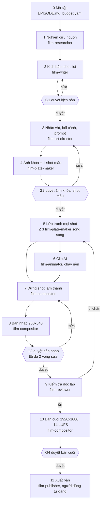

# Quy trình làm một tập phim

Bản cho người đọc. Phiên chính (đạo diễn) làm theo skill `.claude/skills/film-pipeline/`. Schema file và tên:
`docs/CONVENTIONS.md`.

## 1. Sơ đồ



## 2. Khâu, người làm, cổng

| # | Khâu | Ai làm | Đầu ra | Cổng |
|---|---|---|---|---|
| 0 | Mở tập (dự án mới: tạo thư mục Drive và `PROJECT.md` trước) | đạo diễn | `EPISODE.md`, `budget.yaml`, thư mục tập trên Drive | người dùng chốt độ dài, style, trần chi phí |
| 1 | Nghiên cứu nguồn | `film-researcher` | `research.md` (nguyên văn, link, cách đọc tên) | – |
| 2 | Kịch bản, shot list | `film-writer` | `script.md`, `shots.csv` | **G1** |
| 3 | Thiết kế nhân vật, bối cảnh | `film-art-director` | `characters/*/CHARACTER.md`, `locations/*/LOCATION.md`, `prompts/`, `prompts.csv` | – |
| 4 | Ảnh khóa | `film-plate-maker` | ảnh khóa nhân vật + đủ lớp 1 shot mẫu (2K) | **G2** trước khi tạo hàng loạt |
| 5 | Lớp tranh | `film-plate-maker` (≤ 3 song song) | `out/.../plates/`, `prompts.csv`, `anchors.json` | – |
| 6 | Clip AI | `film-animator` (nền) | `out/.../clips/` | – |
| 7 | Dựng shot, âm thanh | `film-compositor` | film.html theo shot, `review/sound-audit.md` | – |
| 8 | Dựng cả tập | `film-compositor` | bản nháp 960×540 | **G3** (tối đa 2 vòng sửa) |
| 9 | Kiểm tra độc lập | `film-reviewer` (chỉ đọc sản phẩm, ghi qc) | `review/qc-<v>.md` | lỗi chặn → quay lại khâu gây lỗi |
| 10 | Bản cuối | `film-compositor` | 1920×1080, -14 LUFS, lưu Drive | **G4** |
| 11 | Xuất bản | `film-publisher` | `publish.md` | người dùng tự đăng |

Cổng duyệt luôn ở phiên chính. Agent không hỏi người dùng, không tự qua cổng. Trước mỗi cổng phiên chính chạy
`python3 tools/check_episode.py episode <thư mục tập>` (ghi `review/check-<v>.txt`); còn ERROR thì chưa trình duyệt.

## 3. Agents

| Agent | Vai | Skill nạp sẵn | Công cụ | Model | Ghi chú |
|---|---|---|---|---|---|
| *(phiên chính)* | Đạo diễn | `film-pipeline` | tất cả | – | giữ cổng, nói chuyện với người dùng, cập nhật EPISODE.md, kéo/đẩy Drive |
| `film-researcher` | Nghiên cứu nguồn | – | WebSearch, WebFetch, Read, Write, Edit, Glob, Grep | sonnet | chỉ ghi `research.md` |
| `film-writer` | Biên kịch | `film-script` | Read, Write, Edit, Glob, Grep | opus | không Bash |
| `film-art-director` | Thiết kế, prompt lớp | `film-prompt-layers` | Read, Write, Edit, Glob, Grep | opus | `memory: project`, không tạo ảnh |
| `film-plate-maker` | Tạo, tách lớp tranh | `film-prompt-layers` | Bash, Read, Write, Edit, Glob, Grep | sonnet | `FILM_AGENT`, `--ledger/--budget` |
| `film-animator` | Clip Seedance | – | Bash, Read, Write, Glob | sonnet | `background: true`, `--ledger/--budget` |
| `film-compositor` | Dựng, âm thanh, render | `film-compose-shot`, `cinecode` | Bash, Read, Write, Edit, Glob, Grep | opus | một agent mỗi tập; không gọi ark.py |
| `film-reviewer` | Kiểm tra độc lập | – | Read, Write, Edit, Glob, Grep | opus | `memory: project`; không Bash, đọc số đo của check_episode; chỉ ghi `review/qc-*.md` và MEMORY.md |
| `film-publisher` | Xuất bản YouTube | – | Read, Write, Edit, Glob, Grep | sonnet | `publish.md`, không tự đăng |
| `film-narrator` | Lồng tiếng lời bình (VieNeu-TTS local, không phí) | – | Bash, Read, Write, Glob, Grep | sonnet | `background: true`; chỉ `tools/tts/vieneu_tts.py`, giọng/mode/seed theo hợp đồng, xong = `--check` đạt; chưa gắn vào khâu nào |

Gọi agent: Claude tự giao theo `description`, hoặc gọi tên trong câu ("giao film-writer viết khâu 2"). Mỗi lần giao có
hợp đồng: đường dẫn tập, khâu, file đầu vào, file đầu ra, trần chi phí, tiêu chí xong. Agent trả về tối đa 10 dòng.
Chỉ `film-plate-maker` và `film-animator` tạo ảnh/video. `memory: project` **không** tự cấp công cụ ghi:
agent nào cần ghi bộ nhớ hoặc báo cáo phải khai báo `Write`/`Edit` trong `tools`. `film-reviewer` có Write/Edit (không
Bash) và prompt chỉ cho ghi `review/qc-*.md` của tập và `.claude/agent-memory/film-reviewer/MEMORY.md`.

## 4. Ngân sách và ledger

- `budget.yaml` trong thư mục tập: `images`, `video_seconds`, `models` (trần riêng theo model).
- Mọi lần tạo ảnh/video:
  `FILM_AGENT=<agent> python3 tools/ark.py image|video ... --ledger out/<project>/ep<NN>/ledger.csv --budget <tập>/budget.yaml`.
  `ark.py` bắt buộc có `--budget` và `--ledger` (thiếu → thoát mã 2), cộng ledger (mỗi request một lần: pending, ok, failed, cut-502) + yêu cầu mới; vượt trần → từ chối, ghi `refused-budget`, thoát mã 3.
- Request bị proxy cắt (502 sau ~30 s) ghi `cut-502` và không thử lại: có thể đã tính phí.
- Ledger ghi bằng khóa file; tối đa 3 plate-maker chạy song song. Kiểm ngân sách và ghi dòng `pending` nằm trong cùng
  một khóa, nên agent song song không vượt trần (CONVENTIONS §7).
- Ảnh pro/4K đi qua Lambda (`lambda/README.md`) và vẫn vào cùng ledger: `ark.py lambda-job prepare` (kiểm trần, dòng
  `pending`, in payload) → Invoke → `ark.py lambda-job finish` (dòng cuối). Không có ledger thì không gọi Lambda.
- Mỗi tập chỉ một phiên tạo ảnh/video tại một thời điểm (ghi vào `## Nhật ký` của EPISODE.md khi bắt đầu khâu 4–6). Có
  hai bản ledger của một tập thì gộp bằng `ark.py ledger-merge`, không lấy bản mới nhất; `ledger_required: true` trong
  `budget.yaml` (bật từ khâu 4) chặn việc tạo ảnh khi chưa kéo ledger (CONVENTIONS §7, §11.6).
- Tiết kiệm nhất ở G2: một ảnh thử (2K hoặc `--fast`) và một shot mẫu được duyệt trước khi tạo hàng loạt.

## 5. Lưu trữ

Repo chỉ giữ lõi dùng lại (công cụ, skill, agent, style pack, mẫu, quy trình). Mọi dữ liệu của dự án nằm trên Google
Drive `ClaudeFilmLab/<ProjectName>/` (gốc lab ID `19yQarw7ATu90uzXjboGP4sy5FzlQhd0y`) – chi tiết `docs/CONVENTIONS.md` §11.

```
ClaudeFilmLab/<ProjectName>/
├── 00_QuanLy/      PROJECT.md (manifest ID) · README_CauTruc (Doc) · TienDo_SanXuat (Sheet)
├── 01_TaiLieuGoc/  _ChoPhanLoai/ · SachThamKhao/ · NguyenVan/ · HinhAnhThamKhao/
├── 02_KinhThu/     SERIES.md · NhanVat/ · BoiCanh/ · PhongCach/
├── 03_KichBan/ep<NN>-<slug>/            chữ của tập (= projects/<project>/ep<NN>-<slug>/)
├── 04_SanXuat/ep<NN>-<slug>/<ngày>/     gói shot, bản nháp; ledger.csv
├── 05_ThanhPham/ep<NN>-<slug>/          bản cuối, xuất bản
└── 99_LuuTru/      bản cũ (không xoá gì)
```

- **Đầu phiên – kéo:** `00_QuanLy/PROJECT.md` trước, rồi kinh thư, tập đang làm và `ledger.csv` về `projects/<project>/`
  và `out/<project>/ep<NN>/` (git bỏ qua). Không có bản làm việc thì không làm tiếp.
- **Cuối mỗi khâu – đẩy:** file chữ đã đổi lên thư mục tương ứng (file mới; bản cũ chuyển vào `99_LuuTru/` với tên có
  giờ), `ledger.csv` nếu có tạo ảnh/video, cập nhật dòng của tập trong `TienDo_SanXuat`. Trước khi dừng phiên cũng đẩy:
  container bị thu hồi khi rảnh → chữ và media chưa đẩy là mất.
- Media: `out/<project>/ep<NN>/{plates,clips,renders}/` (git bỏ qua). Sau khi duyệt:
  `python3 tools/bundle.py out/<project>/ep<NN> --shot s03` → một zip mỗi shot, tải lên Drive
  `ClaudeFilmLab/<ProjectName>/04_SanXuat/ep<NN>-<slug>/<YYYY-MM-DD>/` (người dùng duyệt từng lần tải). Bản nháp
  duyệt cũng vào đó; bản cuối vào `05_ThanhPham/ep<NN>-<slug>/`. Link ghi vào cột `drive_link` của `prompts.csv`.
- Thay đổi lõi (công cụ, skill, style pack) mới commit + push vào repo; dữ liệu dự án không bao giờ commit.

## 6. Chuyển giao giữa phiên

Phiên mới kéo dự án từ Drive rồi đọc `EPISODE.md` trước, không dựa vào lịch sử chat. EPISODE.md giữ: khâu hiện tại (`stage`), cổng đã qua
(`gates` có ngày), ghi chú người dùng nguyên văn, mục đã khóa (không làm lại), việc tiếp theo, nhật ký mỗi khâu (ngày,
kết quả, giờ đẩy Drive). Ghi chú được đổi thành con số/tham số trước khi làm lại; phần người dùng đã khen thì khóa.
